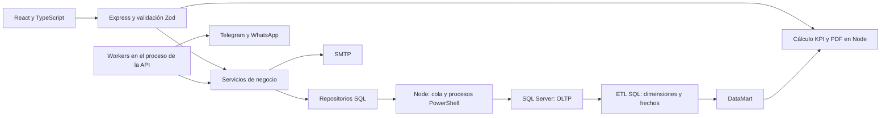

**Auditoría integral de LaPreDigital — 12 de noviembre de 2026**

El proyecto tiene una separación modular adecuada, pero conserva fallos funcionales que afectan la identidad de los estudiantes, las autorizaciones, los bloqueos, el seguimiento y la continuidad del bot. La compilación correcta y las pruebas existentes no cubren todos esos recorridos.

Revisión del directorio de trabajo asociado al commit `71e75b733bfaea622c7d5fdd34abe6dbc83c9c64`, incluidos los cambios locales presentes durante la auditoría. Se contrastaron las reglas del informe v32, especialmente F1–F9 y las secciones 3 y 4. Las reproducciones adicionales utilizaron rollback y transportes simulados. No se ejecutaron cobros ni envíos reales.

Las prioridades expresan el orden recomendado de corrección: **P1**, integridad de datos, interrupción del servicio o incumplimiento de una regla central; **P2**, funcionamiento parcial, información incorrecta o problemas de mantenimiento; **P3**, compatibilidad secundaria. «Reproducido» identifica una comprobación ejecutada; «por código» identifica un recorrido comprobable en las fuentes cuya interfaz o proveedor real no se ejercitó.

**Arquitectura observada**

Rutas, servicios, repositorios y reglas puras tienen responsabilidades reconocibles. El frontend utiliza TypeScript estricto y la mayoría de entradas HTTP se valida con esquemas Zod. Las consultas inspeccionadas parametrizan valores. Telegram y WhatsApp conservan eventos recibidos y estados de despacho, y distinguen preparación de entrega. Son bases útiles para corregir el sistema de forma incremental.

El acoplamiento principal está en los recursos compartidos: API y workers viven en un mismo proceso; las lecturas usan una conexión global con una cola; cada transacción crea otro proceso PowerShell; y algunas operaciones SMTP ocurren dentro de transacciones SQL. En indicadores, SQL almacena los hechos y Node vuelve a leerlos completos para filtrarlos y consolidarlos.

**Fallos prioritarios**

**F01 · P1 · Un mensaje problemático puede detener toda la cola del canal. Reproducido.**

La extracción determinista de disponibilidad agrega valores después de la validación del análisis. El patrón acepta una cantidad de horas arbitrariamente larga y no vuelve a comprobar el límite SQL de 200 caracteres. Un mensaje extremo con 201 dígitos y «horas al día» produjo una disponibilidad de 214 caracteres y un error de truncamiento. No hizo falta que el modelo devolviera un campo inválido: el campo lo agregó el respaldo determinista.

Después, `pollTelegram` registra el error y ejecuta `break`, sin cerrar el evento, limitar reintentos o apartarlo. En dos ciclos consecutivos quedaron pendientes tanto ese mensaje como el siguiente. WhatsApp utiliza el mismo patrón de interrupción ante excepciones. El bloqueo se reprodujo en Telegram con IA y transporte simulados.

Corregir la validación final de todos los campos, incluidos los extraídos por reglas, y aislar eventos que fallan reiteradamente para permitir que otros contactos continúen.

Fuentes: [extracción de horas](C:/Users/USERJSSV/Downloads/AgenteLaPreDigital/server/agent/intents.mjs:323), [campos agregados después de validar](C:/Users/USERJSSV/Downloads/AgenteLaPreDigital/server/agent/intents.mjs:368), [interrupción de Telegram](C:/Users/USERJSSV/Downloads/AgenteLaPreDigital/server/integrations/telegram.mjs:408), [interrupción de WhatsApp](C:/Users/USERJSSV/Downloads/AgenteLaPreDigital/server/integrations/whatsapp.mjs:277).

**F02 · P1 · Se acepta un Estudiante que corresponde al beneficiario de otra persona. Reproducido.**

Con `role = 1` y un `beneficiaryId` existente, el servicio comprueba que el beneficiario exista, pero no compara su `idContactoBeneficiario` con el contacto que participa. Se crearon, dentro de rollback, dos contactos diferentes y una participación de rol Estudiante para el beneficiario del primero usando el segundo contacto. Todas las FK eran válidas.

El control debe verificar la identidad contacto–beneficiario–rol antes de reutilizar el beneficiario. La regla debe proteger las entradas del operador y las llamadas internas. En la consulta agregada de la base operativa no se encontraron estudiantes ya afectados; el fallo es un recorrido permitido por el código.

Fuente: [selección y validación del beneficiario](C:/Users/USERJSSV/Downloads/AgenteLaPreDigital/server/leads/service.mjs:31).

**F03 · P1 · Un mensaje ambiguo levanta bloqueos de varios beneficiarios. Reproducido.**

`recordUnassigned` termina los bloqueos de todos los beneficiarios relacionados con el contacto antes de identificar de quién se habla. Con una madre asociada a dos estudiantes bloqueados, un «Hola» sin participación asignada redujo los bloqueos abiertos de dos a cero. Contradice la regla de F7 de identificar al beneficiario antes de terminar su bloqueo.

El mensaje puede contar provisionalmente como respuesta para las participaciones abiertas, según el informe; la eliminación del bloqueo debe esperar a la asignación final del beneficiario.

Fuentes: [mensaje sin asignar](C:/Users/USERJSSV/Downloads/AgenteLaPreDigital/server/messages/service.mjs:11), [actualización de todos los bloqueos](C:/Users/USERJSSV/Downloads/AgenteLaPreDigital/server/messages/repository.mjs:19).

**F04 · P1 · Una invitación pendiente se envía aunque el destinatario ya haya revocado el canal. Reproducido.**

El despacho comprueba la autorización vigente cuando `idOrigenMensaje = 1`. Las invitaciones directas se crean con origen 2 y quedan fuera de ese control. Se preparó una invitación por Telegram, se revocó la autorización y después se ejecutó el despacho con un doble: se realizó una llamada de envío y el resultado fue `sent: true`, con cero autorizaciones vigentes.

La autorización debe volver a comprobarse al despachar una invitación proactiva, independientemente de que la haya preparado la agenda o el agente. El comportamiento de las respuestas reactivas debe conservar su regla específica.

Fuentes: [control limitado al origen 1](C:/Users/USERJSSV/Downloads/AgenteLaPreDigital/server/integrations/dispatch.mjs:34), [creación de la invitación directa](C:/Users/USERJSSV/Downloads/AgenteLaPreDigital/server/links/direct.mjs:54).

**F05 · P1 · Correo tiene confirmación inicial, pero carece de seguimiento automático posterior. Reproducido.**

El worker considera enviables únicamente WhatsApp y Telegram, y el despachador enumera esos mismos canales. No incluye correo aunque SMTP esté configurado. Un intento vencido de un contacto que solo autorizó correo terminó con `omitido = true` y sin mensaje de envío.

La autorización y los siete registros de agenda existen, pero no se completa el proceso F2 para ese canal. Hace falta integrar correo en la preparación y el despacho, con persistencia del estado y tratamiento de fallos.

Fuentes: [canales habilitados para la agenda](C:/Users/USERJSSV/Downloads/AgenteLaPreDigital/server/workers.mjs:90), [omisión del intento](C:/Users/USERJSSV/Downloads/AgenteLaPreDigital/server/followup/service.mjs:66), [canales del despachador](C:/Users/USERJSSV/Downloads/AgenteLaPreDigital/server/integrations/dispatch.mjs:99).

**F06 · P1 · Se prepara seguimiento con un pago pendiente de validación. Reproducido.**

La agenda comprueba becas pendientes, bloqueos, derivaciones y estado del caso, pero no comprueba un pago confirmado todavía sin validación contractual. Tras registrar ese pago, un intento vencido generó otro mensaje de seguimiento: quedó sin omitir y con `idMensajeEnvio`, mientras `idEventoValidacion` seguía vacío.

F2 exige omitir ese intento. El control debe existir al preparar el mensaje y al despacharlo, porque el pago puede registrarse entre ambos momentos. La pantalla Seguimiento actualmente afirma que ya realiza esa comprobación.

Fuentes: [datos de los intentos vencidos](C:/Users/USERJSSV/Downloads/AgenteLaPreDigital/server/followup/repository.mjs:21), [decisión de omisión](C:/Users/USERJSSV/Downloads/AgenteLaPreDigital/server/followup/service.mjs:46), [comprobación al despachar](C:/Users/USERJSSV/Downloads/AgenteLaPreDigital/server/integrations/dispatch.mjs:34).

**F07 · P1 · El comando de migración ignora `DB_DATABASE`. Confirmado por código y modo de comprobación.**

`tools/migrate.mjs` toma servidor y credenciales, pero no utiliza la base configurada. El archivo que ejecuta contiene `CREATE DATABASE LaPreDigital_OLTP` y `USE LaPreDigital_OLTP`. Configurar `DB_DATABASE=LaPreDigital_OLTP_test` no cambia ese destino. El modo `--check` tampoco informa el nombre de la base que recibirá los cambios.

Esto puede aplicar esquema y triggers en una base diferente de la que el operador pretendía preparar. El destino debe resolverse y comprobarse expresamente antes de ejecutar el script. Durante esta auditoría no se ejecutó esa migración sobre la base operativa.

Fuentes: [comando de migración](C:/Users/USERJSSV/Downloads/AgenteLaPreDigital/tools/migrate.mjs:5), [base fijada en el SQL](C:/Users/USERJSSV/Downloads/AgenteLaPreDigital/script/LaPreDigital_OLTP.sql:1).

**Otros fallos funcionales**

| ID y prioridad | Problema, efecto y evidencia                                                                                                                                                                                                                                                                                                                                                                                                                                                                                                                                            | Corrección propuesta                                                                                                                                                              |
| -------------- | ----------------------------------------------------------------------------------------------------------------------------------------------------------------------------------------------------------------------------------------------------------------------------------------------------------------------------------------------------------------------------------------------------------------------------------------------------------------------------------------------------------------------------------------------------------------------- | --------------------------------------------------------------------------------------------------------------------------------------------------------------------------------- |
| F08 · P2       | **Correo fallido sin recuperación. Reproducido.** SMTP falló en el primer registro; el comprobante confirmó el registro. Al repetir el formulario de solo correo, la rama de contacto existente no volvió a intentar el envío. Hubo una sola llamada SMTP entre ambos envíos del formulario. [Envío y error](C:/Users/USERJSSV/Downloads/AgenteLaPreDigital/server/public/landing.mjs:134), [rama de contacto existente](C:/Users/USERJSSV/Downloads/AgenteLaPreDigital/server/public/landing.mjs:158).                                                                 | Persistir la intención de correo y su estado, con reintentos controlados y una vía segura de recuperación. La confirmación del registro puede conservarse aunque el correo falle. |
| F09 · P2       | **No se conserva la última respuesta expresa de una propuesta. Reproducido.** Se registró un rechazo y luego una aceptación dentro del plazo. La aceptación fue rechazada por el servicio y la propuesta conservó resultado Rechazada. F5 exige conservar la última respuesta expresa. [Bloqueo del cambio](C:/Users/USERJSSV/Downloads/AgenteLaPreDigital/server/proposals/service.mjs:62).                                                                                                                                                                            | Permitir el cambio dentro del plazo conservando los mensajes y definiendo qué ocurre si ya existe contratación.                                                                   |
| F10 · P2       | **Las propuestas vencidas no pasan automáticamente a Sin respuesta. Por código.** El mantenimiento expira pruebas y solicitudes, pero no actualiza propuestas entregadas cuyo plazo terminó. La interfaz puede seguir mostrando «Esperando» aunque la ventana haya vencido; el KPI sí puede clasificarlas por fechas. [Mantenimiento](C:/Users/USERJSSV/Downloads/AgenteLaPreDigital/server/followup/service.mjs:10).                                                                                                                                                   | Aplicar la transición de F5 al vencer el plazo y coordinarla con la aceptación tardía prevista por el informe.                                                                    |
| F11 · P2       | **Resumen y lista de LEADS quedan desactualizados. Por código.** El refresco de cinco segundos termina cuando no hay una participación seleccionada. La consulta de solicitudes públicas solo recarga el espacio de trabajo si aparece una participación nueva. Cambios del bot sobre un caso existente no actualizan estas pantallas en ese escenario. [Condición del refresco](C:/Users/USERJSSV/Downloads/AgenteLaPreDigital/src/state/Workspace.tsx:65).                                                                                                            | Refrescar los datos compartidos de las pantallas operativas o invalidarlos cuando cambian casos existentes; mostrar errores de lectura.                                           |
| F12 · P2       | **El formulario de perfil puede sobrescribir datos nuevos con valores antiguos. Por código.** Sus campos se inicializan al montar el componente. Si el bot modifica el mismo perfil, el refresco actualiza `selected`, pero no esos campos. Guardar un cambio de presupuesto envía también los demás valores antiguos no vacíos. [Estado del formulario](C:/Users/USERJSSV/Downloads/AgenteLaPreDigital/src/features/profiles/ProfileCard.tsx:7), [envío de todos los campos](C:/Users/USERJSSV/Downloads/AgenteLaPreDigital/src/features/profiles/ProfileCard.tsx:30). | Enviar los campos realmente modificados y detectar conflictos de versión al guardar. Actualizar los campos que no tengan cambios locales.                                         |
| F13 · P2       | **El desglose temporal de KPI se recorta silenciosamente a 50 grupos. Reproducido.** Con 60 días y 60 unidades, el total fue 60 pero el desglose devolvió 50 días y sumó 50. También afecta al PDF, que recibe el mismo desglose. El límite de contactos sí se presenta como «primeros 15»; el temporal no indica truncamiento. [Agrupación y recorte](C:/Users/USERJSSV/Downloads/AgenteLaPreDigital/server/kpis/rules.mjs:178).                                                                                                                                       | Devolver todos los periodos solicitados o implementar paginación y una indicación visible de los límites.                                                                         |
| F14 · P2       | **La pantalla Integraciones describe una implementación antigua. Confirmado por código y base.** Afirma que WhatsApp/correo no tienen envío integrado y que el DataMart no está conectado. Existen adaptadores de WhatsApp y SMTP, y el panel lee hechos del DataMart. El estado de integraciones tampoco informa la configuración de WhatsApp ni SMTP. [Texto de alcance](C:/Users/USERJSSV/Downloads/AgenteLaPreDigital/src/pages/Integrations.tsx:124), [respuesta de estado](C:/Users/USERJSSV/Downloads/AgenteLaPreDigital/server/integrations/service.mjs:31).    | Describir la capacidad real de cada canal y mostrar su estado de configuración, recepción, despacho y último error, sin confundir configuración con entrega efectiva.             |
| F15 · P3       | **El acceso local por IPv6 es rechazado. Reproducido.** `Host: localhost:<puerto>` devolvió 200; `Host: [::1]:<puerto>` devolvió 403. Dividir Host por `:` produce `[` para IPv6, aunque `[::1]` figure en la lista permitida. [Lectura del host](C:/Users/USERJSSV/Downloads/AgenteLaPreDigital/server/app.mjs:89).                                                                                                                                                                                                                                                    | Analizar el hostname conservando correctamente los corchetes y el puerto de IPv6.                                                                                                 |

**Riesgos de arquitectura y operación pendientes de verificar bajo carga o con proveedores reales**

- **Efectos SMTP dentro de transacciones SQL.** La invitación directa espera al correo y después inserta el mensaje, dentro de la transacción del agente. Si falla esa inserción o un paso posterior, SQL revierte, pero el correo ya enviado permanece fuera de su control. También se mantienen bloqueos mientras responde SMTP. Registrar primero la intención en una cola transaccional permite separar ese efecto. Fuente: [envío directo](C:/Users/USERJSSV/Downloads/AgenteLaPreDigital/server/links/direct.mjs:44). La recepción real de un correo huérfano no se provocó.
- **Pérdida de exclusión de workers tras reconectar.** El bloqueo de proceso usa `LockOwner = Session` sobre la conexión global. Si esa conexión muere, el adaptador la sustituye, pero `startWorkers` no vuelve a adquirir el bloqueo. Un timeout puede dejar al worker activo sin la exclusión que impide otro proceso. Usar una conexión dedicada y supervisar la pérdida del bloqueo. Fuentes: [bloqueo de sesión](C:/Users/USERJSSV/Downloads/AgenteLaPreDigital/server/workers.mjs:38), [timeout y sustitución](C:/Users/USERJSSV/Downloads/AgenteLaPreDigital/server/db.mjs:52). No se forzó la pérdida de una sesión operativa.
- **Las latencias se propagan entre canales.** El ciclo espera Telegram, WhatsApp, mantenimiento y despachos en ese orden. Una llamada a Ollama admite hasta 120 segundos. Aunque se capturen excepciones por etapa, una espera larga puede retrasar al otro canal y los envíos. Separar las colas con concurrencia acotada, preservando el orden por conversación. Fuentes: [ciclo secuencial](C:/Users/USERJSSV/Downloads/AgenteLaPreDigital/server/workers.mjs:11), [timeout del modelo](C:/Users/USERJSSV/Downloads/AgenteLaPreDigital/server/agent/ollama.mjs:314).
- **Lecturas completas y recursos SQL sin límite de concurrencia.** Cada petición de indicadores obtiene todos los hechos antes de filtrar en JavaScript. El espacio de trabajo también devuelve todos los LEADS. Las consultas de una conexión se serializan, y cada transacción crea un proceso PowerShell con aislamiento Serializable. El coste crece con el histórico y los usuarios concurrentes. Medir con un volumen representativo, trasladar filtros y agregaciones a SQL, paginar las listas y limitar conexiones. Fuentes: [lectura de KPI](C:/Users/USERJSSV/Downloads/AgenteLaPreDigital/server/kpis/service.mjs:9), [adaptador](C:/Users/USERJSSV/Downloads/AgenteLaPreDigital/server/db.mjs:85), [aislamiento](C:/Users/USERJSSV/Downloads/AgenteLaPreDigital/server/sql-worker.ps1:42). No se realizó una prueba de carga.
- **Actualización completa del DataMart.** La recarga obtiene un bloqueo exclusivo, ejecuta las dimensiones y reemplaza los hechos; las lecturas esperan y el bloqueo tiene un plazo de diez segundos. La atomicidad es positiva, pero el crecimiento del OLTP puede convertir la recarga en una pausa visible. El backend no conserva una marca persistente de la última carga que pueda mostrarse junto a la hora de consulta. Fuentes: [bloqueo y carga](C:/Users/USERJSSV/Downloads/AgenteLaPreDigital/server/datamart/service.mjs:52), [fecha mostrada por KPI](C:/Users/USERJSSV/Downloads/AgenteLaPreDigital/server/kpis/service.mjs:49).
- **API de consola sin identidad HTTP por operador.** Host y Origin delimitan el uso local, pero no identifican a un usuario; las operaciones se atribuyen a la cuenta SQL/Windows del servidor. Es una limitación documentada del prototipo. Hace falta autenticación y permisos antes de ofrecer la consola a múltiples operadores o exponer sus operaciones administrativas. No se comprobó una intrusión externa. Fuentes: [restricción de acceso](C:/Users/USERJSSV/Downloads/AgenteLaPreDigital/server/app.mjs:87), [operador SQL](C:/Users/USERJSSV/Downloads/AgenteLaPreDigital/server/shared/repository.mjs:8).
- **Protección desigual de formularios públicos.** El límite de solicitudes se aplica a la landing, pero no a `/api/public/interest`. El limitador conserva una entrada por cada intento, incluidos los rechazados, y su limpieza no impone un máximo estricto de IP activas. El coste de memoria y filtrado puede crecer con el abuso. Fuentes: [rutas públicas](C:/Users/USERJSSV/Downloads/AgenteLaPreDigital/server/public/routes.mjs:90), [almacenamiento de intentos](C:/Users/USERJSSV/Downloads/AgenteLaPreDigital/server/public/rate-limit.mjs:5). No se generó tráfico de ataque.
- **Checkout sin reutilización de sesión.** Cada llamada prepara una nueva sesión mientras no haya pago registrado; no se conserva una sesión abierta para reutilizarla. Debe evaluarse la idempotencia frente a reintentos y el tratamiento de dos pagos externos para una contratación. Fuentes: [creación de checkout](C:/Users/USERJSSV/Downloads/AgenteLaPreDigital/server/contracts/service.mjs:84), [solicitud al proveedor](C:/Users/USERJSSV/Downloads/AgenteLaPreDigital/server/contracts/stripe.mjs:49). Stripe está limitado expresamente a pruebas; no se intentaron cobros.

**Trazabilidad de reglas que todavía está incompleta**

Además de los fallos anteriores, `seguimientoPermitido` se guarda usando únicamente participación Activa y prioridad distinta de Nula; puede quedar verdadero durante una derivación o un bloqueo promocional. [Evaluación](C:/Users/USERJSSV/Downloads/AgenteLaPreDigital/server/priorities/service.mjs:37).

`saveConsent` revoca e inserta incluso al reconfirmar una autorización vigente, mientras la captación común sí reutiliza la autorización. La aceptación de una invitación utiliza esa captación y guarda origen Formulario en lugar de Vinculación. [Reconfirmación](C:/Users/USERJSSV/Downloads/AgenteLaPreDigital/server/consents/service.mjs:22), [origen de captación](C:/Users/USERJSSV/Downloads/AgenteLaPreDigital/server/leads/repository.mjs:237), [aceptación](C:/Users/USERJSSV/Downloads/AgenteLaPreDigital/server/links/service.mjs:25).

No hay un caso de uso completo de correcciones administrativas de evaluaciones y eventos que registre todas las referencias previstas por el informe. Los ETL actuales sí excluyen varias evidencias corregidas; eso no sustituye la operación para registrar la corrección. El listado de evaluaciones iniciales vencidas fija 24 horas en el SQL en lugar de utilizar el parámetro del proceso. [Pendientes](C:/Users/USERJSSV/Downloads/AgenteLaPreDigital/server/pending/service.mjs:78).

Estas diferencias incluyen pendientes que el propio informe ya reconoce en su sección 9.2. La actualización de documentación debe acompañar la corrección para que reglas, pantallas y comportamiento describan el mismo sistema.

**Estado observado de las bases e indicadores**

La base operativa tenía **77 tablas**, coincidentes por nombre con las 77 declaradas en el script. No había FK ni restricciones CHECK deshabilitadas o no confiables. Esta comprobación de metadatos no certifica todas las reglas del negocio ni compara cada definición de columna con el script.

La muestra operativa contenía 11 contactos, 9 beneficiarios, 9 casos, 11 participaciones y 56 mensajes. En el momento de consulta no había eventos pendientes en las bandejas de Telegram y WhatsApp; los ocho despachos registrados estaban en estado `sent`. Los fallos de cola se reprodujeron en pruebas, no se encontraron como atasco presente en esa muestra.

El DataMart **sí estaba poblado y conectado al panel**. Tiene las seis dimensiones de análisis del informe más `DimCaso`, incorporada para relacionar y contar casos mediante una key sustituta; las siete dimensiones tienen identidad propia. Hay cinco hechos y 32 FK. `sysdiagrams`, presente adicionalmente, pertenece a los diagramas de SQL Server.

| Hecho                     | Filas observadas |
| ------------------------- | ---------------: |
| HechoContactoInicial      |               11 |
| HechoAmpliacionPerfil     |                7 |
| HechoVinculacionEconomica |                2 |
| HechoPropuestaComercial   |                7 |
| HechoConversionPagada     |                6 |

Las lecturas de KPI y PDF utilizan el DataMart. El ETL conserva keys sustitutas, medidas y roles de tiempo, y las pruebas comprueban que repetirlo no duplique dimensiones. Las ventanas se comparan como 168 horas; la reconstrucción de autorizaciones ya compara intervalos de vigencia y los logros tempranos ya conservan la marca provisional. Esos dos problemas del contraste anterior no se vuelven a presentar como fallos actuales.

La carga se actualiza manualmente desde el botón o el comando de refresco. Las cifras representan el último contenido cargado. La existencia de resultados en el panel no demuestra actividad real: los escenarios sembrados y los pagos de demostración deben identificarse como simulados al presentar el análisis.

**Verificaciones realizadas y límites**

| Comprobación                                    | Resultado                                                                                                                                     |
| ----------------------------------------------- | --------------------------------------------------------------------------------------------------------------------------------------------- |
| Comprobación de sintaxis JavaScript             | 123 archivos `.mjs` comprobados, sin errores de sintaxis. Inventario de 202 archivos de código, estilos, datos y SQL.                         |
| `npm run build`                                 | Aprobada: TypeScript y compilación Vite.                                                                                                      |
| `npm audit --json`                              | Cero vulnerabilidades reportadas por el registro para las dependencias instaladas. No equivale a una auditoría de seguridad de la aplicación. |
| `npm run format:check`                          | Falló por formato en `README.md`.                                                                                                             |
| `node tools/format-sql.mjs --check`             | Falló por formato en `script/LaPreDigital_OLTP.sql`; este paso quedaba oculto detrás del fallo previo de Prettier.                            |
| Primera suite en `_test`                        | 62 aprobadas y 54 fallidas. Faltaban las 16 tablas auxiliares `App_*` en el OLTP de pruebas.                                                  |
| Suite con esquema auxiliar de pruebas preparado | 114 aprobadas y 2 fallidas, de 116. La integración seed → ETL → KPI aprobó.                                                                   |
| Reproducciones adicionales                      | Confirmaron F01–F06, F08, F09, F13 y F15 con transportes simulados o funciones puras.                                                         |

Los dos fallos restantes de la suite requieren interpretar el entorno:

- El escenario de invitación directa utiliza el teléfono fijo `+51987654321`; ya había dos contactos con ese teléfono en la base de pruebas. La función evita resolver un destinatario ambiguo y el test esperaba un destinatario único. La prueba depende de datos previos y debe generar su propio teléfono único.
- La base de pruebas tenía únicamente los niveles de interés 1–3, mientras el caso de compra requiere el nivel 4. La base operativa sí tenía los cuatro. El script carga el catálogo solamente cuando está vacío, por lo que repetirlo sobre un catálogo parcialmente antiguo no agrega el elemento faltante. Esto evidencia la ausencia de una actualización incremental de catálogos.

La suite no impone globalmente una base de pruebas: su archivo de entorno solo desactiva OpenAI; únicamente la prueba del DataMart fija expresamente las bases `_test`. La auditoría proporcionó las variables de pruebas y desactivó todos los envíos. Conviene exigir esa separación desde el propio comando de tests y preparar un esquema reproducible. El workflow de GitHub comprueba formato y compilación, pero no ejecuta pruebas de negocio.

Para habilitar las pruebas se crearon únicamente las 16 tablas auxiliares faltantes y su trigger de unicidad en `LaPreDigital_OLTP_test`, a partir de la sección correspondiente del script existente. Los escenarios de diagnóstico se revirtieron; pueden quedar saltos normales de IDENTITY. La suite del DataMart reconstruye su base `_test` de forma explícita. No se aplicaron correcciones al código de la aplicación ni se modificaron registros operativos.

No se comprobó una conversación real de extremo a extremo con proveedores externos, recepción real de correo, cobros, comportamiento visual en navegador, restauración de copias de seguridad ni rendimiento bajo carga. Los valores de configuración consultados solo verificaron presencia de credenciales, nunca su validez ni su contenido.

Los logs, resultados JSON de las reproducciones, metadatos y una instantánea de archivos están en la [carpeta de evidencias](C:/Users/USERJSSV/.codex/visualizations/2026/11/12/01a1cd57-f333-7442-81bc-ecff54ed5c68/auditoria-integral).

**Orden de trabajo propuesto**

1. Validar los datos finales del agente y permitir que la cola avance ante eventos fallidos; volver a comprobar autorizaciones antes de invitaciones proactivas.
2. Corregir identidad de Estudiante, asignación de mensajes ambiguos y seguimiento con pago pendiente.
3. Completar el seguimiento por correo y persistir sus envíos pendientes y fallidos.
4. Hacer explícito el destino de migración, preparar catálogos incrementales y aislar las pruebas.
5. Corregir cambios de respuesta, vencimientos de propuestas, refresco de pantallas, conflictos al guardar perfiles y recorte de desgloses.
6. Actualizar textos y documentación; después medir concurrencia y volumen antes de ampliar el uso operativo.
